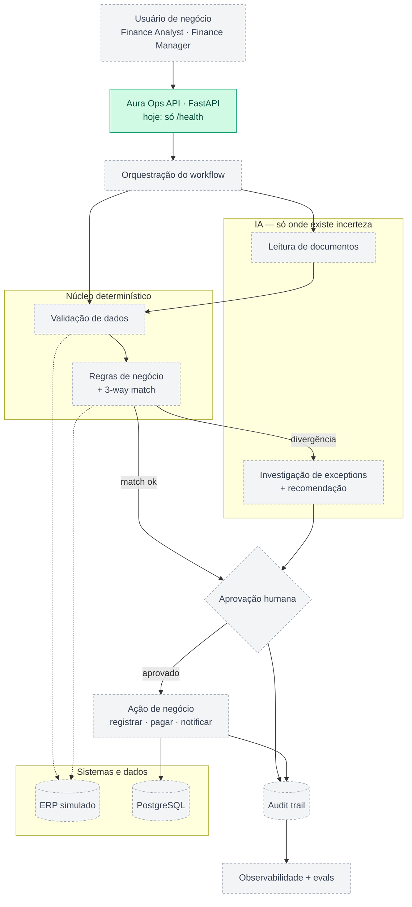
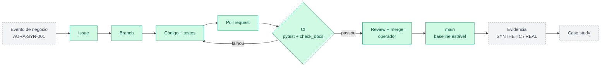

# AURA

> "AURA" e "Aura Ops" são codinomes de trabalho. A disponibilidade das marcas não foi verificada.

## O que é a AURA?

A AURA é um laboratório de engenharia de automação agentic empresarial, criado para construir, testar e operar agentes de IA em workflows corporativos realistas, usando organizações sintéticas, incidentes reproduzíveis e práticas reais de engenharia de software.

Dentro da simulação, a AURA é uma empresa B2B fictícia que constrói o **Aura Ops**: automação auditável de processos empresariais que combina agentes de IA, APIs, dados, regras de negócio e aprovação humana.

## Problema de negócio

Times de Accounts Payable recebem faturas que precisam ser validadas, conferidas contra pedidos de compra e recebimentos, investigadas quando divergem, aprovadas e auditadas — quase sempre à mão. O primeiro workflow da AURA, o **Accounts Payable inteligente**, automatiza com código as partes determinísticas e usa IA só onde existe incerteza real, com um humano aprovando toda ação financeira. Detalhes: [docs/product/AURA-OPS.md](docs/product/AURA-OPS.md).

## Arquitetura



Verde: implementado. Cinza tracejado: planejado.

Princípios: deterministic first (totais, matches e duplicidades são código e SQL), human-in-the-loop para ações financeiras, tudo auditável e nenhuma tecnologia sem problema. Detalhes: [docs/architecture/README.md](docs/architecture/README.md).

## Como o projeto produz trabalho

Cada mudança percorre o mesmo caminho de uma empresa de tecnologia, e cada etapa deixa evidência verificável.



Hoje os eventos de negócio são escritos à mão a partir das personas; o simulador que os gera de forma reproduzível está planejado.

## Capabilities atuais

```text
Stage atual:         Stage 1 — Engineering Core (em andamento)
Produto executável:  só o esqueleto do serviço; ainda sem lógica de Accounts Payable
```

| Capability | Status |
|---|---|
| Documentação, decision log e sistema de memória | IMPLEMENTED |
| `tools/check_docs.py` (links quebrados, consistência do nível de treinamento) | VERIFIED |
| Esqueleto do serviço FastAPI (`GET /health`) | VERIFIED (pytest, CI) |
| CI em todo pull request (pytest + checagem de docs) | VERIFIED (PR #7) |

Todo o resto (validação de faturas, 3-way match, PostgreSQL, agentes, evals) está PLANNED. Ordem e definition of done: [docs/product/ROADMAP.md](docs/product/ROADMAP.md).

### Rodar localmente

```powershell
python -m venv .venv
.\.venv\Scripts\python -m pip install -e ".[dev]"
.\.venv\Scripts\python -m pytest
.\.venv\Scripts\python -m uvicorn aura_ops.main:app
```

Depois abra `http://127.0.0.1:8000/health`.

## Proof

Cada capability aponta aqui para seus testes, PR, execução de CI e métricas, com rótulo SYNTHETIC ou REAL.

| Capability | Testes | PR | CI |
|---|---|---|---|
| Esqueleto do serviço (`GET /health`) e CI | [tests/test_health.py](tests/test_health.py) | [#7](https://github.com/diaquinodev/aura/pull/7) | [execução](https://github.com/diaquinodev/aura/actions/runs/37925319032) |

## Demo

Nenhuma ainda.

## Case studies

Nenhum ainda. Primeiro planejado: Case 001 — Deterministic 3-Way Matching Engine.

## Documentação

- [docs/status/CURRENT.md](docs/status/CURRENT.md): onde o projeto está agora.
- [docs/README.md](docs/README.md): mapa da documentação canônica.
- [AGENTS.md](AGENTS.md): regras para os agentes de IA que trabalham neste repositório.
- [brain/index.md](brain/index.md): decisões, insights e gotchas.
- Laboratório de aprendizado: o operador treina dentro da empresa simulada; `TRAINING_LEVEL = 1` (Guided), ver [docs/learning/README.md](docs/learning/README.md).

## Disclaimer

- **Clientes sintéticos.** A AURA-SYN-001 e qualquer outro cliente são fictícios.
- **Datasets e eventos de negócio sintéticos.** Nenhum dado real de fatura, fornecedor, pagamento ou pessoa; incidentes e solicitações são simulados.
- **Engenharia real.** O código, os testes e a infraestrutura são reais.
- Toda métrica tem rótulo SYNTHETIC ou REAL. Resultado sintético nunca é resultado comercial.
